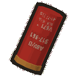
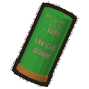
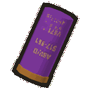
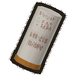
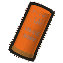

# More Shotgun Shells 🎯

An add-on for [ShotgunPlus](https://thunderstore.io/c/lethal-company/p/SleepyMiles/ShotgunPlus/): four new shells, each with its own colour and job. Every player needs the mod; all settings come from the host.

> **Every shell is off by default.** Turn on the ones you want in the config.

## Shells

| Shell | Store | Scrap | What it does |
|---|---|---|---|
| <br>**Buck Shell** | $50 | common | The vanilla shell, from ShotgunPlus (it scans as Buck Shell). **10 pellets**, normal spread. Enemies take 1, 2, 2, 3, 3... damage depending on how many pellets land (6 if all hit). 20 per pellet to a player. |
| <br>**Slug Shell** | $70 | uncommon | **One precise shot** instead of a spread: **4 damage**, no spread at any range. 80 to a player. In Choke mode it just flies straight. |
| <br>**Bird Shell** | $50 | rare | **20 small pellets**, a much wider spread. **0.4 per pellet**: weaker per pellet than Buck, but **8** if all of them hit, so it's best close to medium range. 10 per pellet to a player. |
| <br>**Magnum Shell** | $150 | rarest | **6 heavy, high-power pellets**, normal spread. **3 per pellet**: 4 hits are 12, enough to drop an **Eyeless Dog** in one shot. 40 per pellet to a player. |
| <br>**Dragon Shell** | $150 | rarest | **8 incendiary pellets**, medium spread, with fiery orange streaks. **0.5 per pellet**, then the enemy **burns for 2 damage over 2 s** (you see it burning). A **Forest Keeper** hit by it **catches fire** (the same fire as from an explosion) and burns to death. 15 per pellet to a player; players don't burn. |

Damage to enemies is in shovel hits (an Eyeless Dog has 12 HP, a Thumper 4, a Forest Keeper 38). Players have 100 HP.

- **Only the plastic is coloured.** The brass and the print stay, on the ground, in your hand while you reload and in the open gun
- **Reloading:** the first shell in your inventory goes in. An empty gun loads two in one go only when you have two of the same shell; a different shell needs another press of R
- **The top right shows what's loaded,** in the shells' colours, like ```Reload (Slug, Buck): [R]```. The first one fires next
- **Every fire mode works with every shell:** Choke bursts into that shell's own spread, Double fires each barrel's own shell
- **Nutcrackers:** now and then one loads these shells (**10%** per reload, both barrels) and fires them at you. Each of the 2 shells a dead Nutcracker drops has a **10%** chance to be one of them. Which one follows the scrap rarities (Slug most often, Magnum and Dragon least)
- Bought shells are tools (no scrap value, kept on the ship when everyone dies); shells found as scrap sell for a little
- `info slug`, `info dragon`, ... in the terminal tells what each does

## Config ⚙
```BepInEx/config/Miles.MoreShotgunShells.cfg```

| Section | Settings |
|---|---|
| Slug Shell | Enabled (false), Price (70), ScrapRarity (6), Damage (4), PlayerDamage (80) |
| Bird Shell | Enabled (false), Price (50), ScrapRarity (3), Pellets (20), DamagePerPellet (0.4), PlayerDamagePerPellet (10) |
| Magnum Shell | Enabled (false), Price (150), ScrapRarity (1), Pellets (6), DamagePerPellet (3), PlayerDamagePerPellet (40) |
| Dragon Shell | Enabled (false), Price (150), ScrapRarity (1), Pellets (8), DamagePerPellet (0.5), PlayerDamagePerPellet (15), BurnDamage (2), BurnSeconds (2), BurnForestKeepers (true) |
| Nutcracker | LoadChance (10 %), DropChance (10 %) |

Buck Shell's price and rarity (10) are in ShotgunPlus' config.

## Credits 💛
- Made for ShotgunPlus. The shells are recoloured copies of the vanilla shell
